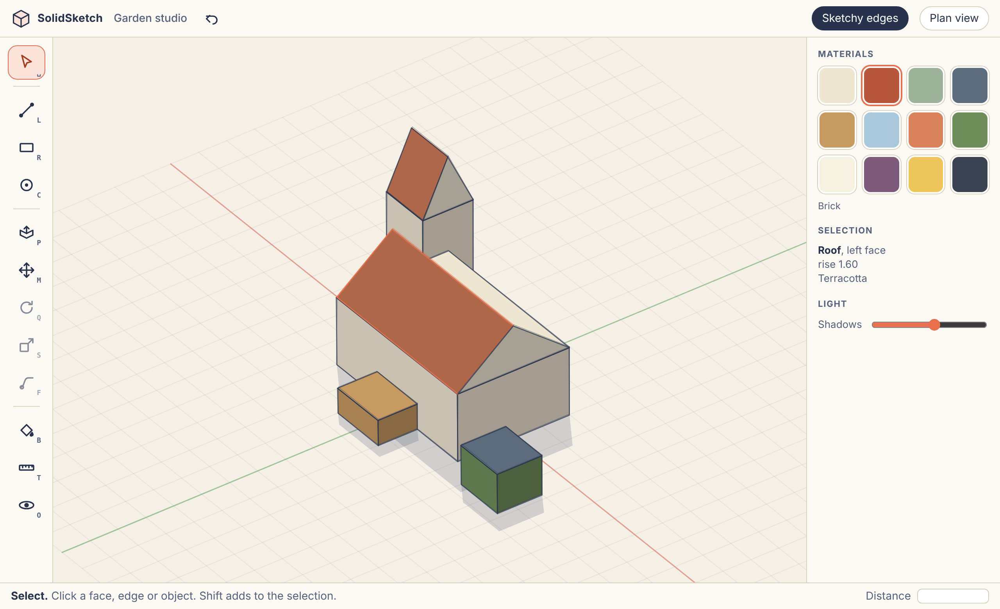
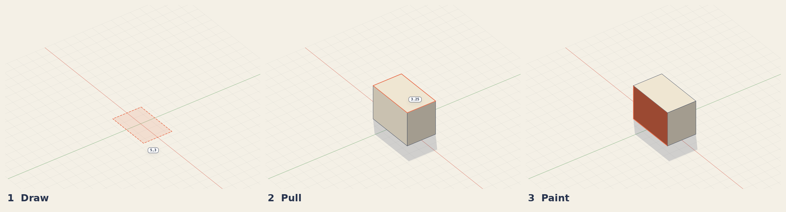
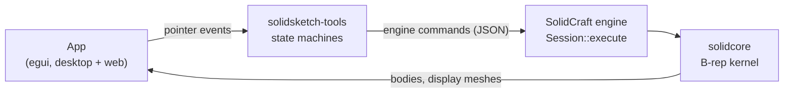

<h1 align="center">SolidSketch™</h1>

<p align="center">
  <strong>Sketch it. Pull it. Paint it.</strong><br />
  A friendly 3D modeler for people who think with their hands, built on a real CAD engine.
</p>



*The interface design, rendered from the [clickable prototype](docs/prototype/index.html). The app itself is
being built; see [Status](#status).*

## The idea

Most 3D software asks you to plan before you draw: pick a plane, constrain a sketch, name a feature,
read a timeline. That is right for machine parts. It is the wrong first minute for a garden shed, a
stage set, a game level, a piece of furniture, or an idea you want to see before it escapes.

SolidSketch keeps the first minute simple:

1. **Draw** a shape on the ground or on any face.
2. **Pull** it into a solid, and push and pull faces until it looks right.
3. **Paint** it, light it, and show it to someone.



Type a number at any moment to make it exact: `5,3` while drawing a rectangle, `3.25` while pulling a
face. Everything else is the pointer.

## Three promises

- **It feels like drawing.** No timeline, constraint dialogs or feature trees on screen. A dozen tools,
  one-letter keys, and a status bar that always says what to do next.
- **It is real geometry underneath.** SolidSketch drives the [SolidCraft](https://github.com/tangency-labs/solidcraft)
  engine and its B-rep kernel, so a model is a true solid: it measures, exports (STEP, STL, 3MF, glTF)
  and prints, not just something that looks right on screen.
- **It looks like art, not engineering.** Paper-warm canvas, pencil-style edges, soft shadows, a tray of
  materials, plan view when you want a drawing.

## Tools

| Tool | Key | Runs on the engine as |
|---|---|---|
| Select | Space | selection |
| Line | L | `sketch.line` |
| Rectangle | R | `sketch.rectangle.two_point` |
| Circle | C | `sketch.circle.center` |
| Push/Pull | P | `solid.offset_face` |
| Move | M | `solid.move` |
| Rotate | Q | planned |
| Scale | S | `solid.scale` |
| Follow Me | F | `solid.sweep` |
| Paint | B | `appearance.paint` |
| Tape Measure | T | planned |
| Orbit | O | camera |

The tools are plain logic in [`crates/tools`](crates/tools): pointer events in, engine commands out,
no screen and no kernel. That keeps every behaviour a unit test, and lets the same code run on the
desktop and in the browser.

## How it fits together



SolidCraft is included as a git submodule at [`solidcraft/`](solidcraft), pinned to a known commit. The
shared SolidCraft crates (viewport, theme, UI kit) are built for other front ends to use, which is how
SolidSketch gets its 3D view without copying it.

## Status

Early. This repository has the design, the tool logic, the checks that tie it to the engine, and a
first testable app that runs in the browser and on the desktop: draw a shape on the ground, pull it up
into a block, pull its top face again, orbit around it.

| Piece | State |
|---|---|
| Interface design, as a clickable [prototype](docs/prototype/index.html) | Done |
| Tool logic: Line, Rectangle, Circle, Push/Pull (faces, drawn profiles, bosses and pockets), value box, the draw-and-pull loop | Done, 92 unit tests |
| Every command the tools emit exists in SolidCraft | Checked by [`scripts/check-command-ids.sh`](scripts/check-command-ids.sh) |
| The same commands run on the real engine | Written (not yet run by the author), runs in CI ([`crates/engine-check`](crates/engine-check)) |
| First testable app ([`apps/solidsketch`](apps/solidsketch)): ground drawing, pull into a block, orbit | Written, built by CI; plain look, not the art look yet |
| Web build, published from `main` | [`web-deploy.yml`](.github/workflows/web-deploy.yml) |
| Desktop downloads on every version tag | [`release.yml`](.github/workflows/release.yml) |
| Picking any face on screen, the art look, Rotate, Tape | Next: see [PLAN.md](PLAN.md) |

## Try it

**In the browser:** <https://withshalom.github.io/solidsketch/> is the app built from `main`.
(Once the repository's Pages setting is on "GitHub Actions" and `main` has the app.)

**On your desktop:** the latest release has `solidsketch-linux-x86_64.tar.gz`,
`solidsketch-windows-x64.zip` and `solidsketch-macos-arm64.zip` under
[Releases](https://github.com/withshalom/solidsketch/releases/latest). Unzip and run. The builds are not
signed yet, so macOS and Windows will ask you to confirm.

In the app: `R` Rectangle, `C` Circle, `L` Line, `P` Push/Pull, `O` Orbit. Click two corners, press `P`,
drag the shape up. Type a number and press Enter to make it exact. `Ctrl+Z` undoes. Middle-drag orbits
and the wheel zooms. Push/Pull takes the newest shape (picking any face is next).

The design prototype is a separate page: open [`docs/prototype/index.html`](docs/prototype/index.html) in a browser. Press `R` and click twice on
the ground, press `P` and drag a top face up, press `B` and click a face. It is a design prototype of
how the tools feel, not the app.

## Build and test

```sh
git clone --recurse-submodules https://github.com/withshalom/solidsketch
cd solidsketch
cargo test                                      # the tools, no other dependencies
scripts/check-command-ids.sh                    # the engine knows every command we emit
cargo test --manifest-path crates/engine-check/Cargo.toml   # run them on the engine (large build)
cargo run --release --manifest-path apps/solidsketch/Cargo.toml   # the desktop app
cd apps/solidsketch && trunk serve --release    # the browser app (needs: rustup target add wasm32-unknown-unknown; cargo install trunk)
```

The README pictures come from the prototype: `scripts/render-readme-visuals.py` (Python with Playwright).

## Plan

[PLAN.md](PLAN.md) has the phases, the hard problems and the decisions still open.

## Licence and independence

MIT OR Apache-2.0, at your option ([MIT](LICENSE-MIT), [Apache-2.0](LICENSE-APACHE)), the same as
SolidCraft, which this project builds on and thanks.

SolidSketch is an independent project. It is not affiliated with, sponsored by or endorsed by Trimble,
SketchUp, Autodesk, Dassault Systèmes or any other 3D software vendor. Tool names and keys are
conventional drawing vocabulary; no other product's code, icons or text are used.

SolidSketch™ is a trademark of WithShalom Studios. See [TRADEMARK.md](TRADEMARK.md).
